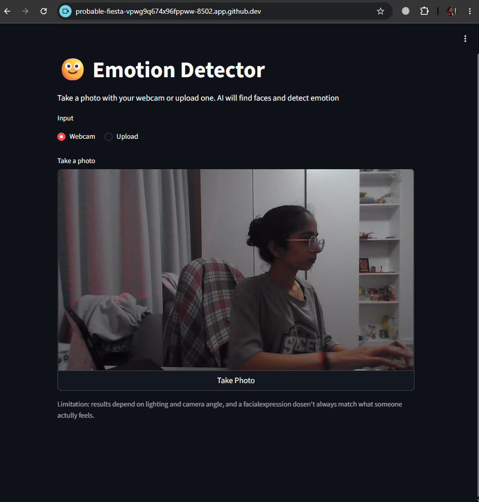

# 🙂 Emotion Detector

A web app that detects faces in a webcam photo or an uploaded image and predicts each person's emotion, with a probability chart for all 7 emotions.



## Features
- Take a photo with your webcam or upload an image
- Detects multiple faces and draws a labeled box around each
- Shows a bar chart of the 7 emotion probabilities (happy, sad, angry, fear, surprise, disgust, neutral)
- Shows a clear message when no face is found

## Tech stack
Python · DeepFace · OpenCV · Streamlit · NumPy · Pillow

## How it works
1. The image is converted from RGB to OpenCV's BGR format.
2. DeepFace detects each face and a pretrained neural network scores 7 emotions.
3. OpenCV draws the bounding box and the top emotion label.
4. Streamlit displays the result and a probability chart.

## Run it yourself
```bash
git clone https://github.com/vansheekaparmar/emotion-detector.git
cd emotion-detector
pip install -r requirements.txt
streamlit run app.py
```
Tested with Python 3.11/3.12. The first analysis is slower because DeepFace downloads its model.

## Limitations
- Accuracy depends on lighting, camera angle and image quality.
- Emotion models can be biased by their training data, for example across skin tones, ages and cultures.
- A facial expression does not always reflect what a person actually feels, so results should be treated as a rough guess, not a fact.

## Future improvements
- Truly live video with streamlit-webrtc
- Accuracy evaluation on the FER-2013 dataset

## Author
Built by Vansheeka Parmar
