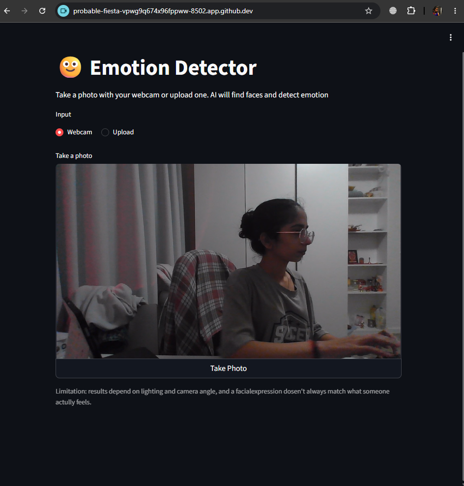

# 🙂 Emotion Detector

A computer vision web app that detects faces and predicts emotions, either from a **webcam photo / uploaded image** or from **live webcam video**. It shows a labeled box around each face and a probability chart for all 7 emotions.

**🔗 Live demo:** (https://emotion-detector-juzoqy9qzdhhcxraohdjk6.streamlit.app/)



## What's new in v2
- **Live Video page:** press START and the app labels emotions on your webcam stream in near-real-time (labels update about once per second).
- Face analysis runs in a **background thread**, so the video stays smooth while the AI model works.
- The photo / upload version is still available as the main page.

Earlier version: see the [v1.0 release](https://github.com/vansheekaparmar/emotion-detector/releases) (photo only).

## Features
- Take a webcam photo or upload an image
- Live webcam emotion detection (Live Video page)
- Detects multiple faces and draws a labeled box around each
- Bar chart of the 7 emotion probabilities: happy, sad, angry, fear, surprise, disgust, neutral
- Tries several face detectors in sequence to find faces more reliably
- Shows a clear message when no face is found

## Tech stack
Python · DeepFace · OpenCV · TensorFlow (via DeepFace) · Streamlit · streamlit-webrtc · NumPy · Pillow

## How it works
1. The image or video frame is converted to OpenCV's BGR format.
2. [DeepFace](https://github.com/serengil/deepface) finds each face and a pretrained neural network scores 7 emotions.
3. If one face detector fails, the app tries the next one (OpenCV, then YuNet).
4. OpenCV draws the bounding box and the top emotion label.
5. Streamlit displays the result and the probability chart.

**Live video:** the video callback only draws the most recent results, which is fast. A separate background thread keeps analyzing the newest frame. This way the AI model's delay (up to about a second) never freezes the video.

## Project structure
```
emotion-detector/
├── app.py               # Photo / upload page
├── emotion.py           # Face detection, emotion analysis and drawing
├── pages/
│   └── 1_Live_Video.py  # Live webcam page (streamlit-webrtc)
├── requirements.txt
└── README.md
```

## Run it yourself
```bash
git clone https://github.com/vansheekaparmar/emotion-detector.git
cd emotion-detector
pip install -r requirements.txt
streamlit run app.py
```
Use Python 3.11 or 3.12, because TensorFlow doesn't support the newest Python versions yet. The first analysis is slower because DeepFace downloads its model.

## Privacy
This app does not save or store images or video. Frames are processed in memory only to produce the result on screen.

## Limitations
- Accuracy depends on lighting, camera angle, glasses and image quality.
- Emotion models can be biased by their training data, for example across skin tones, ages and cultures.
- A facial expression does not always reflect what a person actually feels. Treat results as a rough guess, not as a fact.
- Live video uses WebRTC. On some networks (for example university, company or mobile networks) the connection can fail because the cloud deployment has no TURN server. The photo page works everywhere.

## What I learned
- How computer vision models work with images as arrays of numbers
- Fixing real dependency problems, such as pinning `opencv-python-headless<5` because OpenCV 5 removed a feature DeepFace needs
- Running slow AI
